# Финучёт — личный учёт доходов и расходов

Учебный fullstack-проект (курс «Fullstack-разработка», 1 семестр). Один проект развивается на протяжении пяти лабораторных работ: от интерфейса на mock-данных до полноценного приложения на FastAPI + PostgreSQL + React.

## Назначение

Приложение помогает вести личный бюджет: записывать доходы и расходы, раскладывать их по категориям, задавать месячные лимиты (бюджеты) и смотреть отчёты — куда уходят деньги и как меняется баланс по месяцам. Данные можно выгрузить в CSV.

Целевой пользователь — человек, который хочет контролировать свои траты без сложных бухгалтерских программ.

## Пользовательские сценарии

1. **Записать операцию.** Пользователь открывает «Операции», нажимает «Добавить», указывает тип (доход/расход), сумму, категорию, дату и комментарий.
2. **Найти операции.** Пользователь фильтрует список по типу, категории и тексту комментария, редактирует или удаляет запись.
3. **Настроить категории.** Пользователь ведёт отдельные списки доходных и расходных категорий.
4. **Контролировать бюджет.** Пользователь задаёт лимит на категорию и видит, какая часть лимита уже израсходована в текущем месяце; превышение подсвечивается.
5. **Посмотреть отчёт.** Пользователь смотрит структуру расходов по категориям и динамику доходов/расходов по месяцам, выгружает операции в CSV.
6. **Войти в систему.** Пользователь регистрируется и входит, чтобы видеть только свои данные (реализуется в ЛР4).

## Экраны

| Маршрут | Экран | Содержание |
|---|---|---|
| `/` | Обзор | Баланс, доходы и расходы за месяц, последние операции |
| `/transactions` | Операции | Таблица с фильтрами, форма добавления/редактирования |
| `/categories` | Категории | Доходные и расходные категории |
| `/budgets` | Бюджеты | Лимиты по категориям с прогрессом расходования |
| `/reports` | Отчёты | Графики по категориям и месяцам, экспорт CSV |
| `/login`, `/register` | Вход, регистрация | Формы (без логики до ЛР4) |
| `*` | 404 | Страница «не найдено» |

## Стек

- **Frontend:** React, TypeScript, Vite, React Router, MUI (Material UI) + MUI X Charts.
- **Backend:** Python 3.14, FastAPI, SQLAlchemy 2 (async, asyncpg), Alembic, Pydantic.
- **База данных:** PostgreSQL 17 (в Docker).
- **Контроль версий:** Git.

## Структура репозитория

```
lab01_05/
├── frontend/          клиентское приложение (React + TypeScript + Vite)
├── backend/           REST API (FastAPI + SQLAlchemy + PostgreSQL)
└── docs/screenshots/  скриншоты экранов
```

Frontend организован по методологии Feature-Sliced Design:

```
frontend/src/
├── app/        точка сборки: провайдер темы, роутер
├── pages/      экраны, по одному срезу на маршрут
├── widgets/    крупные блоки интерфейса (каркас с навигацией)
├── entities/   бизнес-сущности: типы и mock-данные
│   ├── transaction/
│   ├── category/
│   └── budget/
└── shared/     переиспользуемые UI-компоненты и утилиты форматирования
```

Слой `features/` (пользовательские действия с логикой) появится в ЛР3.

## Запуск frontend

Требуется Node.js 22+ и pnpm 9+.

```bash
cd frontend
pnpm install
pnpm dev        # http://localhost:5173
```

Другие команды:

```bash
pnpm build      # проверка типов (tsc) и production-сборка в dist/
pnpm lint       # статический анализ (oxlint)
pnpm preview    # просмотр production-сборки
```

На этапе ЛР1 все данные — mock (`src/entities/*/mock.ts`), запросов к серверу нет.

## Скриншоты

| Обзор | Операции |
|---|---|
| 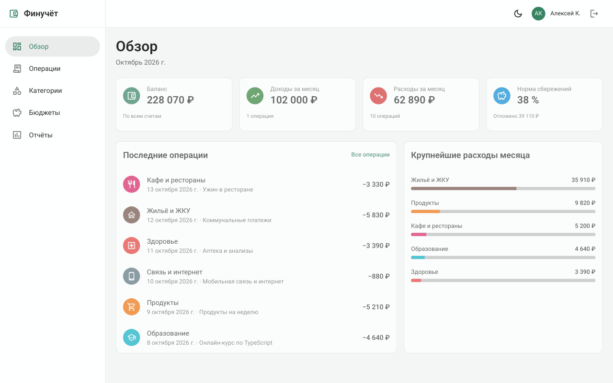 | 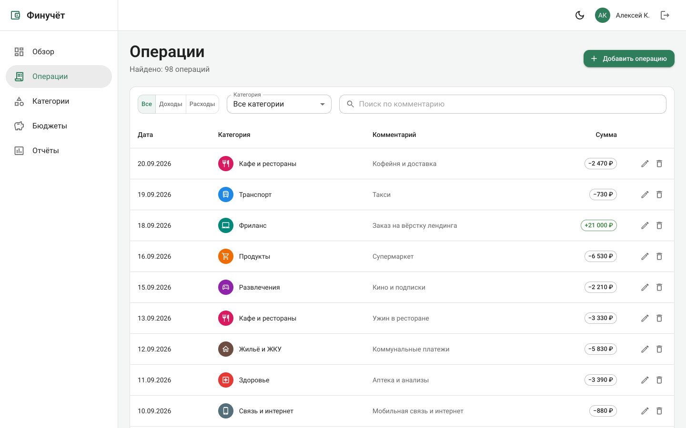 |

| Форма операции | Категории |
|---|---|
| 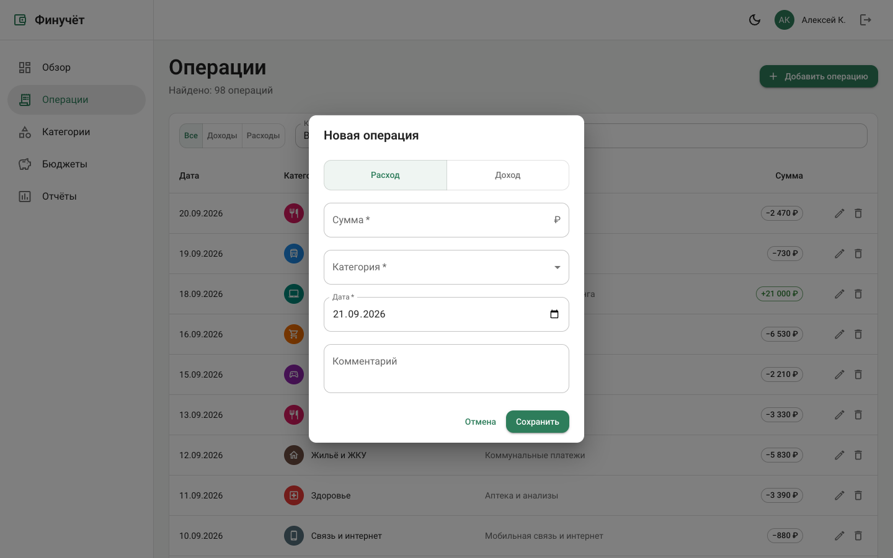 | 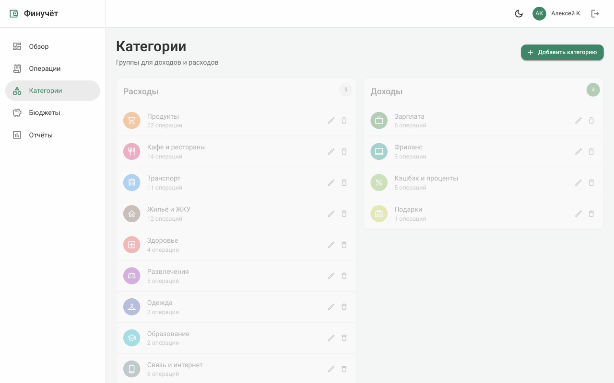 |

| Бюджеты | Отчёты |
|---|---|
| 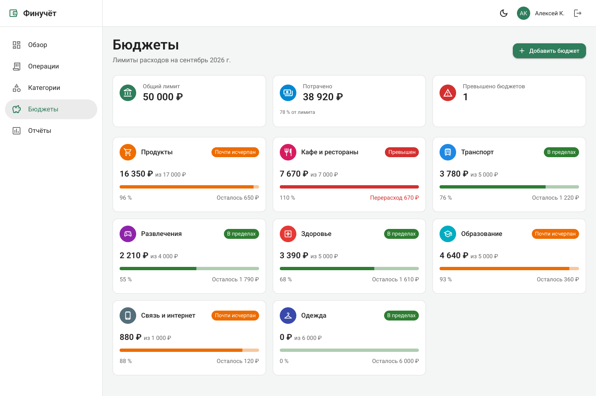 | 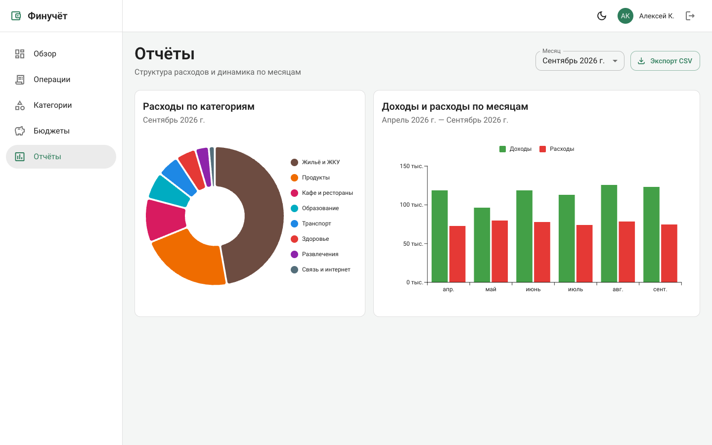 |

| Вход | Регистрация |
|---|---|
| 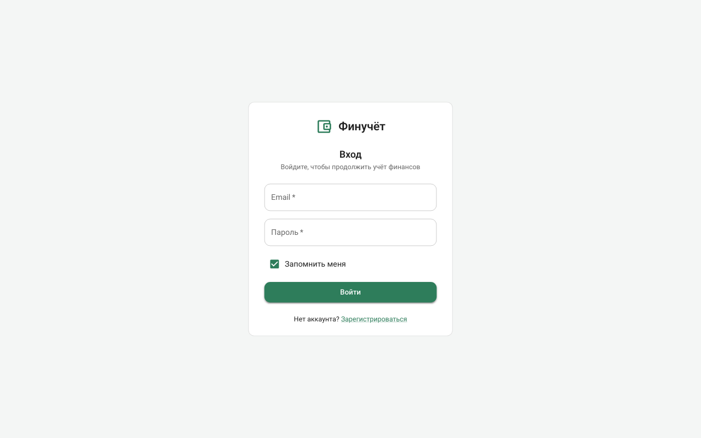 | 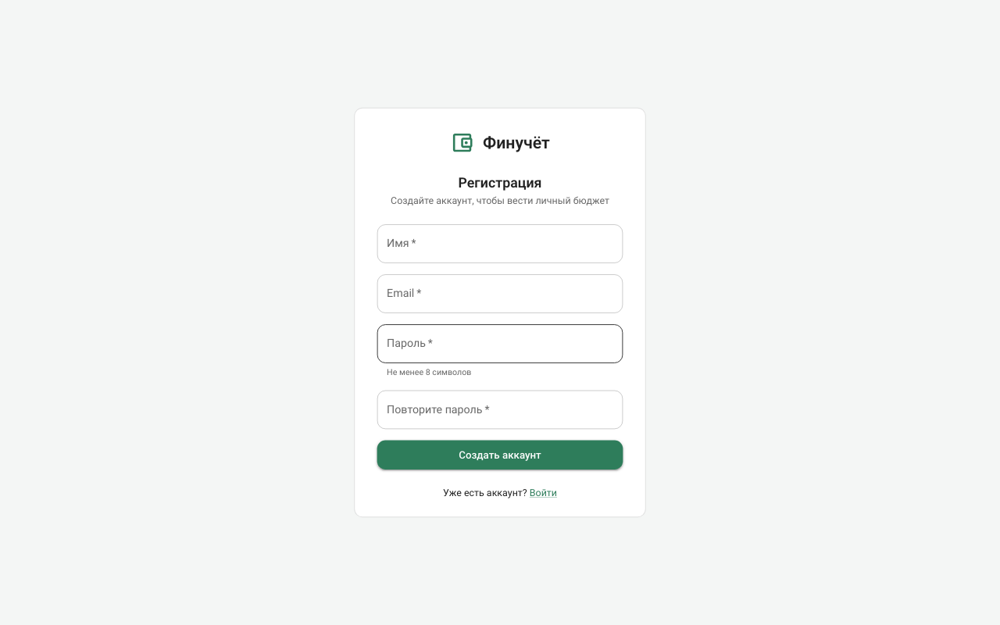 |

| 404 | Тёмная тема |
|---|---|
| 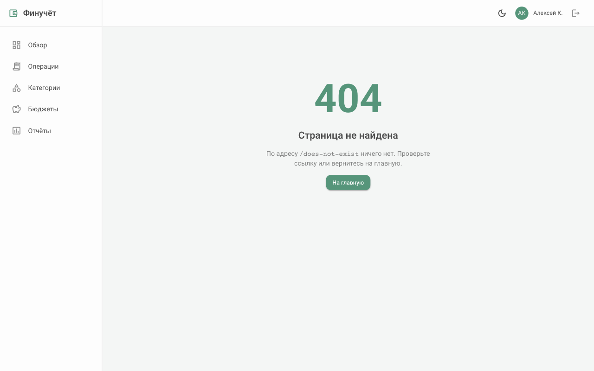 | 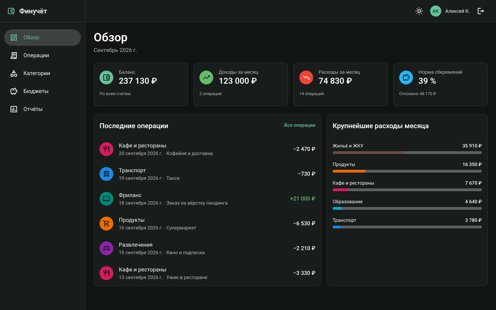 |

Мобильная версия (ширина 390 px):

| Обзор | Меню | Операции |
|---|---|---|
| 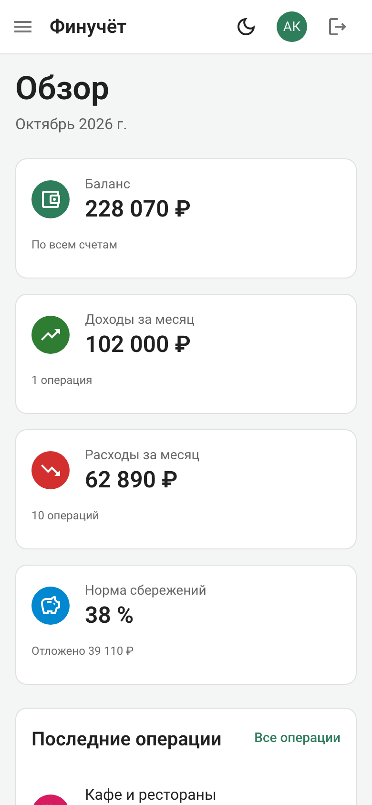 | 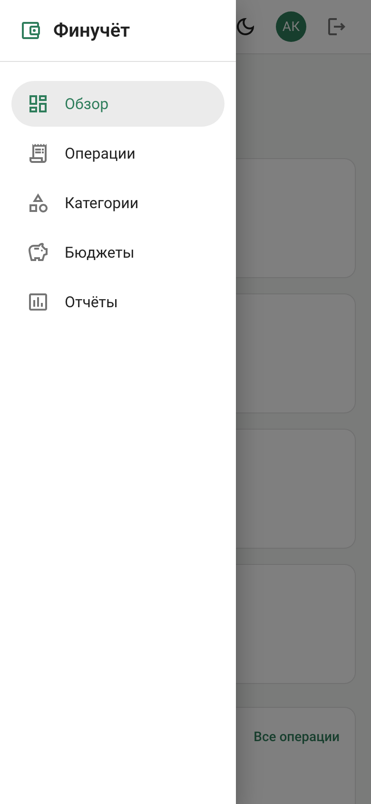 | 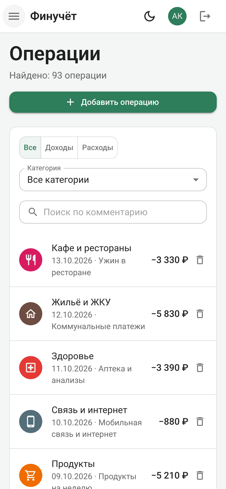 |

## Backend

### Структура

```
backend/
├── app/
│   ├── main.py        сборка приложения: роутеры, обработчики ошибок
│   ├── config.py      настройки из переменных окружения (.env)
│   ├── db.py          движок, фабрика сессий, зависимость SessionDep
│   ├── errors.py      доменные ошибки → HTTP-статусы
│   ├── models/        модели SQLAlchemy (таблицы)
│   ├── schemas/       схемы Pydantic: валидация запросов и ответов
│   ├── services/      операции с данными и бизнес-правила
│   ├── api/           маршруты API, по роутеру на сущность
│   └── seed.py        заполнение БД демонстрационными данными
├── migrations/        миграции Alembic
└── docker-compose.yml PostgreSQL для локальной разработки
```

### Модель данных

```
categories 1 ──< transactions
categories 1 ──○ budgets
```

| Таблица | Поля | Ограничения |
|---|---|---|
| `categories` | `id`, `name`, `type` (`income`/`expense`), `color`, `icon` | `name` уникально в пределах `type` |
| `transactions` | `id`, `category_id` → `categories.id`, `amount`, `date`, `comment` | `amount > 0`; удалить категорию с операциями нельзя (`ON DELETE RESTRICT`) |
| `budgets` | `id`, `category_id` → `categories.id`, `limit` | одна запись на категорию, только для расходных; удаляется вместе с категорией (`ON DELETE CASCADE`) |

Суммы хранятся как `NUMERIC(12,2)`. Тип операции (доход/расход) не хранится отдельно, а берётся из её категории. Так операция не может противоречить своей категории. Бюджет — месячный лимит на категорию, действует каждый месяц.

Пользователи и привязка данных к ним появятся в ЛР4.

### API

Интерактивная документация — http://localhost:8000/docs.

| Метод | Путь | Назначение |
|---|---|---|
| `GET` | `/categories?type=` | список категорий |
| `GET`, `PATCH`, `DELETE` | `/categories/{id}` | получить, изменить, удалить категорию |
| `POST` | `/categories` | создать категорию |
| `GET` | `/transactions` | операции с фильтрами `type`, `category_id`, `q`, `date_from`, `date_to` и пагинацией `page`, `size` (≤ 100); ответ `{"items": [...], "total": N}` |
| `GET`, `PATCH`, `DELETE` | `/transactions/{id}` | получить, изменить, удалить операцию |
| `POST` | `/transactions` | создать операцию |
| `GET` | `/budgets` | список бюджетов |
| `GET`, `PATCH`, `DELETE` | `/budgets/{id}` | получить, изменить лимит, удалить бюджет |
| `POST` | `/budgets` | создать бюджет |

Ошибки возвращаются в формате `{"detail": ...}`:

| Статус | Когда |
|---|---|
| `404` | записи из URL не существует |
| `409` | конфликт с существующими данными: дубликат категории или бюджета, удаление категории с операциями, смена типа категории с операциями или бюджетом |
| `422` | некорректные данные: ошибки валидации полей, ссылка на несуществующую категорию, бюджет на доходную категорию |

### Запуск backend

Требуется Python 3.14, [uv](https://docs.astral.sh/uv/) и Docker.

```bash
cd backend
cp .env.example .env          # задайте свой пароль БД
docker compose up -d --wait   # PostgreSQL на localhost:5432
uv sync                       # зависимости
uv run alembic upgrade head   # создание таблиц
uv run python -m app.seed     # демонстрационные данные (очищает таблицы!)
uv run fastapi dev app/main.py  # http://localhost:8000
```

Другие команды:

```bash
uv run alembic revision --autogenerate -m "..."  # новая миграция после изменения моделей
uv run alembic downgrade base                    # откатить все миграции
uv run ruff check . && uv run ruff format .      # линтер и форматирование
docker compose down                              # остановить БД (данные остаются в volume pgdata)
```
