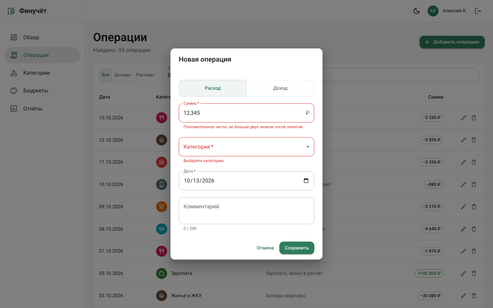
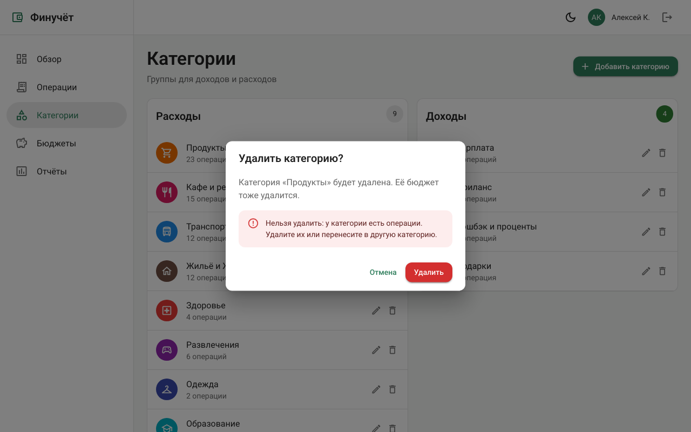
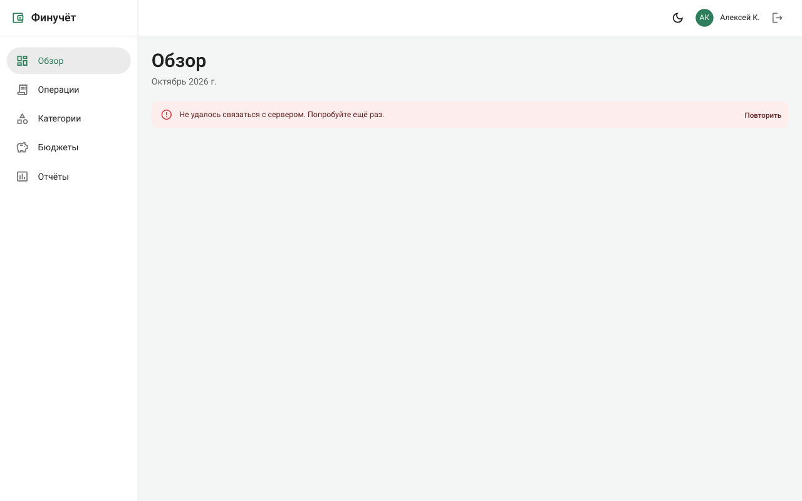
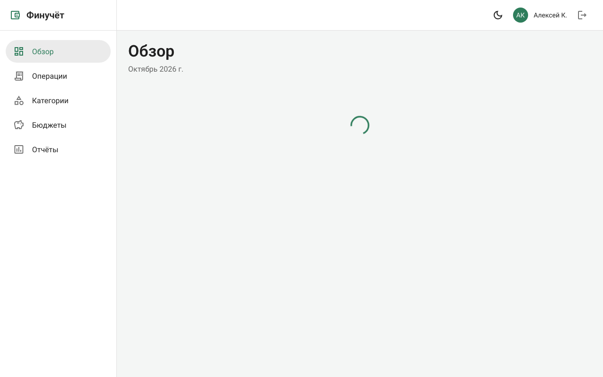
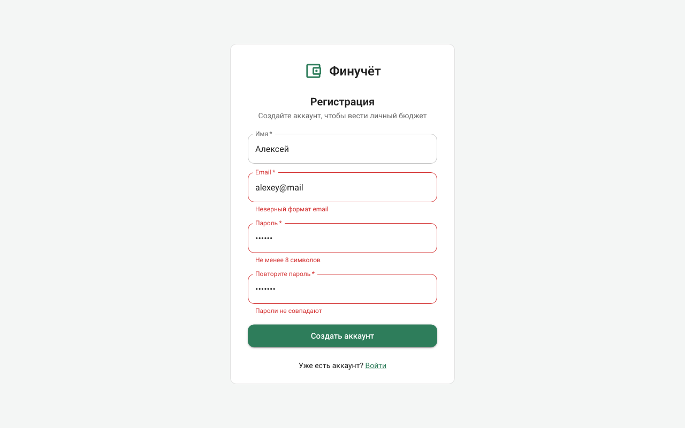
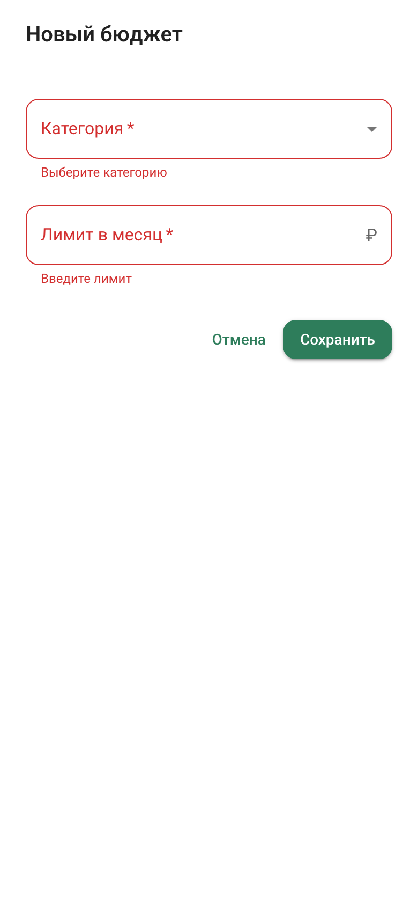

# Финучёт — личный учёт доходов и расходов

Учебный fullstack-проект (курс «Fullstack-разработка», 1 семестр). Один проект развивается на протяжении пяти лабораторных работ: от интерфейса на mock-данных до полноценного приложения на FastAPI + PostgreSQL + React.

## Назначение

Приложение помогает вести личный бюджет: записывать доходы и расходы, раскладывать их по категориям, задавать месячные лимиты (бюджеты) и смотреть отчёты — куда уходят деньги и как меняется баланс по месяцам. Данные можно выгрузить в CSV.

Целевой пользователь — человек, который хочет контролировать свои траты без сложных бухгалтерских программ.

## Пользовательские сценарии

1. **Записать операцию.** Пользователь открывает «Операции», нажимает «Добавить», указывает тип (доход/расход), сумму, категорию, дату и комментарий.
2. **Найти операции.** Пользователь фильтрует список по типу, категории и тексту комментария, редактирует или удаляет запись.
3. **Настроить категории.** Пользователь ведёт отдельные списки доходных и расходных категорий.
4. **Контролировать бюджет.** Пользователь задаёт лимит на категорию и видит, какая часть лимита уже израсходована в текущем месяце; превышение подсвечивается.
5. **Посмотреть отчёт.** Пользователь смотрит структуру расходов по категориям и динамику доходов/расходов по месяцам, выгружает операции в CSV.
6. **Войти в систему.** Пользователь регистрируется и входит, чтобы видеть только свои данные. Выход завершает сессию (см. «Аутентификация»).

## Экраны

| Маршрут | Экран | Содержание |
|---|---|---|
| `/` | Обзор | Баланс, доходы и расходы за месяц, последние операции |
| `/transactions` | Операции | Таблица с фильтрами, форма добавления/редактирования |
| `/categories` | Категории | Доходные и расходные категории |
| `/budgets` | Бюджеты | Лимиты по категориям с прогрессом расходования |
| `/reports` | Отчёты | Графики по категориям и месяцам, экспорт CSV |
| `/login`, `/register` | Вход, регистрация | Формы входа и регистрации; доступны только без входа |
| `*` | 404 | Страница «не найдено» |

Все экраны, кроме входа и регистрации, требуют входа. Без входа приложение открывает `/login`, а после входа возвращает на исходный экран.

## Стек

- **Frontend:** React, TypeScript, Vite, React Router, MUI (Material UI) + MUI X Charts, TanStack Query (загрузка и кэш данных), React Hook Form + Zod (формы и проверка полей).
- **Backend:** Python 3.14, FastAPI, SQLAlchemy 2 (async, asyncpg), Alembic, Pydantic.
- **База данных:** PostgreSQL 17 (в Docker).
- **Контроль версий:** Git.

## Структура репозитория

```
lab01_05/
├── frontend/          клиентское приложение (React + TypeScript + Vite)
├── backend/           REST API (FastAPI + SQLAlchemy + PostgreSQL)
└── docs/screenshots/  скриншоты экранов
```

Frontend организован по методологии Feature-Sliced Design:

```
frontend/src/
├── app/        точка сборки: провайдеры темы и запросов, роутер, защита маршрутов
├── pages/      экраны, по одному срезу на маршрут
├── widgets/    крупные блоки интерфейса (каркас с навигацией)
├── features/   пользовательские действия: формы, удаление, выход
│   ├── transaction-form/    добавление и изменение операции
│   ├── category-form/       добавление и изменение категории
│   ├── budget-form/         добавление бюджета и изменение лимита
│   ├── delete-transaction/  удаление операции с подтверждением
│   ├── delete-category/
│   ├── delete-budget/
│   └── logout/              выход из приложения
├── entities/   бизнес-сущности: типы, демо-данные, функции запросов
│   ├── transaction/
│   ├── category/
│   ├── budget/
│   └── session/  текущий пользователь, вход, регистрация, выход
└── shared/
    ├── api/    HTTP-клиент с обновлением токена; имитация сервера для данных
    ├── lib/    форматирование, склонения, проверка денежных сумм
    └── ui/     общие компоненты: состояния загрузки, диалоги форм и подтверждения
```

Срез `features/*` содержит схему проверки полей (Zod), форму (React Hook Form) и мутацию TanStack Query. После успешного сохранения мутация сбрасывает кэш нужных запросов, и все экраны с этими данными загружают их заново.

### Модуль данных

До подключения backend (ЛР5) данные хранятся в памяти браузера. Файлы `entities/*/api.ts` повторяют запросы backend из раздела «API»: те же параметры фильтров и пагинации, числовые `id`, тип операции берётся из категории. Функции отвечают через 400 мс и отказывают так же, как backend: `404`, `409` (дубликат категории, удаление категории с операциями, смена типа категории с операциями или бюджетом, второй бюджет на категорию), `422` (несуществующая категория, бюджет на доходную категорию). Перезагрузка страницы возвращает демо-набор из `entities/*/mock.ts`. Модуль данных общий для всех пользователей: backend уже разделяет данные по владельцу, интерфейс покажет это после подключения в ЛР5.

Экраны читают данные через `useQuery`, поэтому каждый экран показывает загрузку, ошибку с кнопкой «Повторить» и пустой список.

Ошибку сервера можно вызвать параметром адреса `?fail=<сущность>`, где сущность — `transactions`, `categories` или `budgets`. Пример: http://localhost:5173/budgets?fail=budgets. Параметр работает только в режиме разработки (`pnpm dev`); production-сборка его не читает.

## Запуск frontend

Требуется Node.js 22+ и pnpm 9+.

```bash
cd frontend
pnpm install
pnpm dev        # http://localhost:5173
```

Другие команды:

```bash
pnpm build      # проверка типов (tsc) и production-сборка в dist/
pnpm lint       # статический анализ (oxlint)
pnpm preview    # просмотр production-сборки
```

Вход, регистрация и выход работают через backend: запустите его (см. «Запуск backend»). Dev-сервер Vite передаёт запросы `/api/*` на `http://localhost:8000`. Бюджеты, категории и операции пока берутся из модуля данных в памяти (см. «Модуль данных»).

## Скриншоты

| Обзор | Операции |
|---|---|
|  |  |

| Форма операции | Категории |
|---|---|
|  |  |

| Бюджеты | Отчёты |
|---|---|
|  |  |

| Вход | Регистрация |
|---|---|
|  |  |

| 404 | Тёмная тема |
|---|---|
|  |  |

Мобильная версия (ширина 390 px):

| Обзор | Меню | Операции |
|---|---|---|
|  |  |  |

Формы, состояния и диалоги (ЛР3):

| Ошибки ввода в форме операции | Отказ при удалении категории |
|---|---|
|  |  |

| Ошибка загрузки (`?fail=budgets`) | Загрузка |
|---|---|
|  |  |

| Ошибки на регистрации | Форма бюджета, мобильная |
|---|---|
|  |  |

## Backend

### Структура

```
backend/
├── app/
│   ├── main.py        сборка приложения: роутеры, обработчики ошибок
│   ├── config.py      настройки из переменных окружения (.env)
│   ├── db.py          движок, фабрика сессий, зависимость SessionDep
│   ├── errors.py      доменные ошибки → HTTP-статусы
│   ├── models/        модели SQLAlchemy (таблицы)
│   ├── schemas/       схемы Pydantic: валидация запросов и ответов
│   ├── services/      операции с данными и бизнес-правила
│   ├── api/           маршруты API, по роутеру на сущность
│   └── seed.py        заполнение БД демонстрационными данными
├── migrations/        миграции Alembic
└── docker-compose.yml PostgreSQL для локальной разработки
```

### Модель данных

```
users      1 ──< refresh_sessions
users      1 ──< categories
categories 1 ──< transactions
categories 1 ──○ budgets
```

| Таблица | Поля | Ограничения |
|---|---|---|
| `users` | `id`, `email`, `name`, `password_hash`, `created_at` | `email` уникален, хранится в нижнем регистре |
| `refresh_sessions` | `id`, `user_id` → `users.id`, `token_hash`, `expires_at`, `revoked_at`, `created_at` | `token_hash` уникален; удаляется вместе с пользователем |
| `categories` | `id`, `user_id` → `users.id`, `name`, `type` (`income`/`expense`), `color`, `icon` | `name` уникально в пределах пользователя и `type` |
| `transactions` | `id`, `category_id` → `categories.id`, `amount`, `date`, `comment` | `amount > 0`; удалить категорию с операциями нельзя (`ON DELETE RESTRICT`) |
| `budgets` | `id`, `category_id` → `categories.id`, `limit` | одна запись на категорию, только для расходных; удаляется вместе с категорией (`ON DELETE CASCADE`) |

Суммы хранятся как `NUMERIC(12,2)`. Тип операции (доход/расход) не хранится отдельно, а берётся из её категории. Так операция не может противоречить своей категории. Бюджет — месячный лимит на категорию, действует каждый месяц.

Владелец записан только у категории. Операции и бюджеты принадлежат пользователю через свою категорию. Так операция не может принадлежать одному пользователю, а её категория — другому.

### API

Интерактивная документация — http://localhost:8000/docs.

| Метод | Путь | Назначение |
|---|---|---|
| `POST` | `/auth/register` | регистрация и вход: `{"email", "name", "password"}` → access token и refresh cookie |
| `POST` | `/auth/login` | вход: `{"email", "password", "remember"}` → access token и refresh cookie |
| `POST` | `/auth/refresh` | новый access token по refresh cookie |
| `POST` | `/auth/logout` | отзыв refresh token текущей сессии, удаление cookie |
| `GET` | `/auth/me` | текущий пользователь |
| `GET` | `/health` | проверка работы (публичный) |
| `GET` | `/categories?type=` | список категорий |
| `GET`, `PATCH`, `DELETE` | `/categories/{id}` | получить, изменить, удалить категорию |
| `POST` | `/categories` | создать категорию |
| `GET` | `/transactions` | операции с фильтрами `type`, `category_id`, `q`, `date_from`, `date_to` и пагинацией `page`, `size` (≤ 100); ответ `{"items": [...], "total": N}` |
| `GET`, `PATCH`, `DELETE` | `/transactions/{id}` | получить, изменить, удалить операцию |
| `POST` | `/transactions` | создать операцию |
| `GET` | `/budgets` | список бюджетов |
| `GET`, `PATCH`, `DELETE` | `/budgets/{id}` | получить, изменить лимит, удалить бюджет |
| `POST` | `/budgets` | создать бюджет |

Маршруты `/categories`, `/transactions`, `/budgets` и `/auth/me` требуют заголовок `Authorization: Bearer <access token>`. Каждый маршрут работает только с данными текущего пользователя.

Ошибки возвращаются в формате `{"detail": ...}`:

| Статус | Когда |
|---|---|
| `401` | нет access token, он неверен или истёк; неверный email или пароль; refresh token неверен, истёк или отозван |
| `404` | записи из URL не существует или она принадлежит другому пользователю |
| `409` | конфликт с существующими данными: email уже зарегистрирован, дубликат категории или бюджета, удаление категории с операциями, смена типа категории с операциями или бюджетом |
| `422` | некорректные данные: ошибки валидации полей, ссылка на несуществующую или чужую категорию, бюджет на доходную категорию |

### Аутентификация

| | Access token | Refresh token |
|---|---|---|
| Формат | JWT (HS256): `sub` — id пользователя, `type`, `iat`, `exp` | случайная строка 256 бит |
| Срок действия | 15 минут (`ACCESS_TOKEN_TTL_MINUTES`) | 30 дней (`REFRESH_TOKEN_TTL_DAYS`) |
| Где у клиента | в памяти страницы, заголовок `Authorization` | cookie `refresh_token`: `HttpOnly`, `SameSite=Strict`, `Path=/auth`; `Secure` при `REFRESH_COOKIE_SECURE=true` |
| Где на сервере | не хранится, проверяется подпись `JWT_SECRET` | в `refresh_sessions` хранится только SHA-256 токена |

- **Пароли** хешируются алгоритмом Argon2id (библиотека `pwdlib`). Вход с неизвестным email тоже проверяет хеш, поэтому время ответа не показывает, есть ли такой пользователь.
- **Вход** создаёт запись в `refresh_sessions`. Без флажка «Запомнить меня» (`"remember": false`) cookie живёт до закрытия браузера.
- **Обновление** выдаёт новый access token, если запись сессии есть, не отозвана и не истекла. Иначе — `401` с причиной: `Invalid refresh token`, `Refresh token has expired` или `Refresh token has been revoked`.
- **Выход** записывает `revoked_at` в сессию и удаляет cookie. После этого refresh token этой сессии не работает. Уже выданный access token действует до конца своих 15 минут. Другие сессии пользователя (например, в другом браузере) продолжают работать.

Frontend хранит access token только в памяти, а не в `localStorage`. Refresh token скрипты страницы прочитать не могут: cookie помечена `HttpOnly`. При открытии страницы приложение получает access token через `/auth/refresh`. Если сервер отвечает `401`, HTTP-клиент (`shared/api/http.ts`) один раз обновляет access token и повторяет запрос; одновременные запросы ждут одного общего обновления. Если обновить токен нельзя, приложение открывает `/login`. Выход очищает кэш запросов TanStack Query.

### Запуск backend

Требуется Python 3.14, [uv](https://docs.astral.sh/uv/) и Docker.

```bash
cd backend
cp .env.example .env          # задайте пароль БД и JWT_SECRET (openssl rand -hex 32)
docker compose up -d --wait   # PostgreSQL на localhost:5432
uv sync                       # зависимости
uv run alembic upgrade head   # создание таблиц
uv run python -m app.seed     # демонстрационные пользователи и данные (очищает таблицы!)
uv run fastapi dev app/main.py  # http://localhost:8000
```

Демонстрационные пользователи после `app.seed`:

| Email | Пароль | Данные |
|---|---|---|
| `demo@example.com` | `demo12345` | 13 категорий, 8 бюджетов, 98 операций |
| `maria@example.com` | `maria12345` | 4 категории, 3 бюджета, 56 операций |

Миграция `add users and refresh sessions` удаляет существующие категории, бюджеты и операции: у старых записей нет владельца. После `alembic upgrade head` запустите `app.seed` заново.

Проверка через curl (`-c`/`-b` сохраняют и отправляют refresh cookie):

```bash
curl -c jar -X POST localhost:8000/auth/login -H 'content-type: application/json' \
  -d '{"email":"demo@example.com","password":"demo12345"}'      # {"access_token": ...}
curl localhost:8000/categories -H "Authorization: Bearer <access_token>"
curl -b jar -X POST localhost:8000/auth/refresh                  # новый access token
curl -b jar -c jar -X POST localhost:8000/auth/logout            # 204, сессия отозвана
```

Другие команды:

```bash
uv run alembic revision --autogenerate -m "..."  # новая миграция после изменения моделей
uv run alembic downgrade base                    # откатить все миграции
uv run ruff check . && uv run ruff format .      # линтер и форматирование
docker compose down                              # остановить БД (данные остаются в volume pgdata)
```
